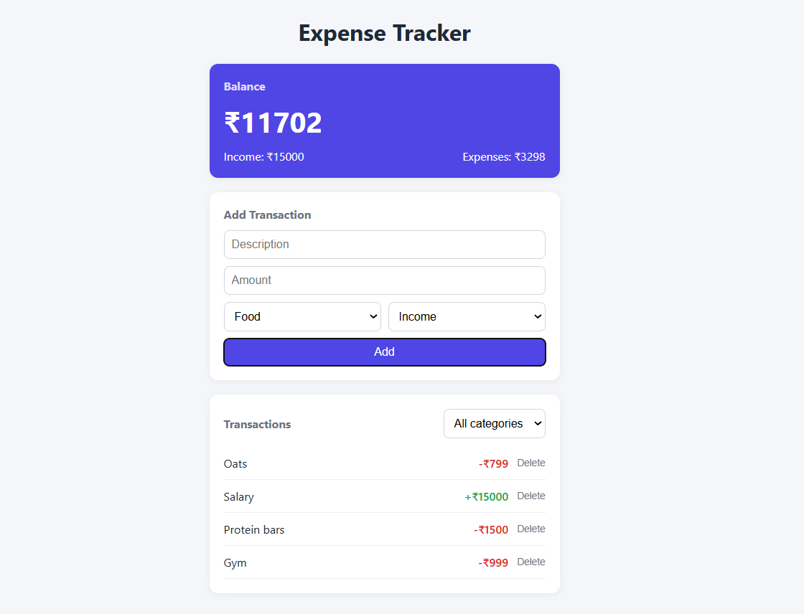

# Expense Tracker

A clean, responsive expense tracker built with vanilla JavaScript. Add income and expenses, see your running balance, filter by category, and keep your data between visits with localStorage.

**Live demo:** https://waghmare-amit.github.io/expense-tracker-js/



## Features

- Add income or expense entries with a description, amount, category (food, bills, other) and type
- Running balance with total income and total expenses, updated instantly
- Transaction list with a delete button on every entry
- Filter transactions by category (the balance always covers all entries)
- Data persists across page refreshes using localStorage
- Income shown in green and expenses in red
- Empty state message when there is nothing to show
- Responsive layout that works on phones and desktops

## Tech Stack

- HTML5
- CSS3 (custom properties, flexbox, grid, media queries)
- JavaScript (ES6), no frameworks or libraries

## How It Works

The app keeps all entries in a single `transactions` array, which is the source of truth. Every change (add or delete) follows the same flow: update the array, save it to localStorage, redraw the list with `renderTransactions()`, and recalculate totals with `updateBalance()`. The page is always a drawing of the array, never edited by hand.

Key concepts used:
- DOM selection and creation (`getElementById`, `createElement`, `appendChild`)
- Event listeners and event delegation for delete buttons
- Array methods: `filter`, `reduce`, `forEach`
- `localStorage` with `JSON.stringify` and `JSON.parse`
- `data-` attributes to link buttons to transactions

## Run Locally

```bash
git clone https://github.com/waghmare-amit/expense-tracker-js.git
cd expense-tracker-js
```

Then open `index.html` in your browser. No build step or dependencies needed.

## Project Structure

```
expense-tracker-js/
├── index.html
├── style.css
├── script.js
└── screenshot.png
```

## Planned Features

- Monthly tracking and summaries
- Charts for spending by category
- Data export

## Author

Amit Waghmare
GitHub: [@waghmare-amit](https://github.com/waghmare-amit)